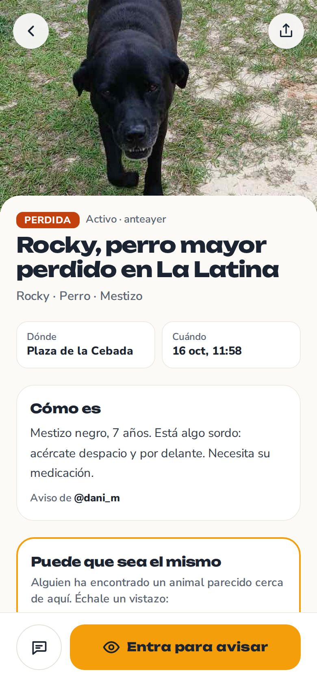
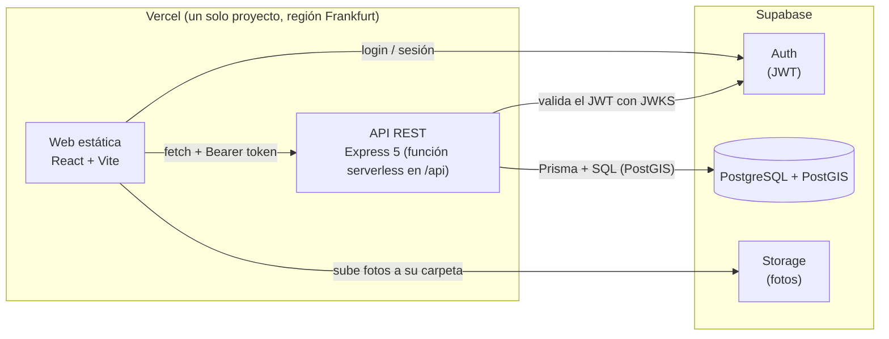

# Furrly 🐾

[](https://github.com/nabildb/Furrly/actions/workflows/ci.yml)

Red social para dueños de mascotas centrada en lo que más importa cuando algo sale mal:
**encontrar mascotas perdidas**. Avisos geolocalizados, avistamientos que dibujan el recorrido del animal,
alertas a los vecinos de la zona y mensajes para coordinarse. Y, el resto del tiempo, una comunidad
para compartir fotos de tus mascotas.

**🌐 Demo:** https://furrly-rouge.vercel.app &nbsp;·&nbsp; Proyecto de portfolio de 2.º de DAW

<p align="center">
  
  
  
</p>

> Móvil primero; en escritorio la navegación pasa a una barra lateral y las páginas a dos columnas.
> La demo tiene datos de ejemplo (vecinos, mascotas, avisos y publicaciones alrededor de Madrid centro).
> Puedes explorarla sin cuenta o registrarte para publicar, avisar de un avistamiento o escribir mensajes.

## Qué se puede hacer

**Mascotas perdidas y encontradas**
- Publicar un aviso de **perdida** o **encontrada** con un asistente de 3 pasos: qué ha pasado, dónde y cuándo, y detalles con fotos.
- **Mapa a pantalla completa** con los avisos activos en un radio, filtros por tipo y especie, y búsqueda de zonas.
- **"La he visto"**: los avistamientos se numeran y dibujan en el mapa el recorrido de la mascota.
- **Alertas por zona**: cada usuario marca su barrio y un radio, y recibe una notificación cuando se publica un aviso dentro,
  también como **aviso push** en el móvil aunque no tenga Furrly abierta (la web es una PWA instalable).
- **Contacto y mensajes**: el autor puede dejar teléfono o email (solo visibles con sesión), y cualquiera puede escribirle por mensaje privado desde el aviso.

**Comunidad**
- Carnet de cada mascota, publicaciones con foto, likes, comentarios y seguir mascotas.
- Feed "Siguiendo" (las mascotas que sigues) y "Explorar" (todo lo reciente) con scroll infinito.
- Buscar perfiles por nombre o @usuario.
- Notificaciones de likes, comentarios, seguidores, avistamientos y avisos resueltos.

**Cuenta y moderación**
- Registro con email o **con Google** (la primera vez se elige el nombre de usuario), login y recuperación de contraseña.
  Perfil público y zona de alertas privada. [Política de privacidad](https://furrly-rouge.vercel.app/privacidad).
- Denunciar avisos, publicaciones, comentarios, usuarios o conversaciones.
- **Bloquear** a un usuario: no podéis escribiros ni interactuar con vuestras publicaciones, y dejas de recibir sus avisos.
- Límites contra el spam: 30 mensajes por hora y 10 conversaciones nuevas al día por usuario.
- Borrar la cuenta con todos sus datos y fotos (derecho de supresión del RGPD).

## Arquitectura



- **La web y la API comparten dominio** (`/api`), así que no hay CORS. La API es la única que toca la base de datos:
  las tablas tienen RLS activado **sin políticas**, de modo que nadie puede leerlas directamente con la clave pública de Supabase.
- **Las fotos las sube el navegador** directamente a Storage, cada usuario solo en su carpeta (políticas del bucket).
  La API solo acepta URLs de esa carpeta.

## Decisiones técnicas que me gustaría destacar

- **Búsquedas geoespaciales con PostGIS.** `ST_DWithin` sobre columnas `geography` con índice GiST para "avisos en X km".
  Las alertas por zona usan el radio **de cada usuario**; antes se filtra por el radio máximo (50 km) para que Postgres pueda usar el índice.
- **Reglas de negocio en la base de datos.** `CHECK` (un aviso de pérdida siempre tiene mascota, `resolved_at` solo si está resuelto),
  claves compuestas que hacen imposibles los likes o seguidores duplicados y una conversación única por pareja de usuarios
  (par ordenado con `CHECK user_a < user_b` + `UNIQUE`).
- **Operaciones idempotentes.** Like, seguir y denunciar son `PUT`/`DELETE` o `createMany({ skipDuplicates })`:
  repetir un clic no falla ni duplica nada, y solo notifica la primera vez.
- **Paginación por cursor** en el feed, las notificaciones y los mensajes, no por `offset`: no se repiten ni se saltan elementos aunque entren nuevos mientras haces scroll.
- **No leídos calculados, no almacenados.** Cada conversación guarda hasta cuándo ha leído cada lado; el número de no leídos sale de una consulta (`LATERAL` + subconsulta).
- **Privacidad por defecto.** El microchip solo se devuelve al dueño, la zona de alertas nunca es pública
  y el contacto de un aviso solo se ve con sesión (la API usa un middleware de **sesión opcional**).
- **Web Push sin librerías.** El cifrado de extremo a extremo del RFC 8291 (ECDH P-256 + HKDF + AES-128-GCM) y la firma VAPID
  del RFC 8292 están implementados con `node:crypto` y `jose`, y se comprueban con el **vector de prueba oficial del RFC**.
  Solo se aceptan endpoints de servicios de push conocidos, para que nadie use la API para hacer peticiones a otros servidores (SSRF).
- **Seguridad comprobada, no solo prometida** ([SECURITY.md](SECURITY.md)): consultas siempre parametrizadas (la CI falla si aparece SQL sin parámetros),
  tests que lanzan inyección SQL, tokens falsificados y *mass assignment* contra la API, CSP estricta que los tests end-to-end
  respetan igual que producción, y CodeQL + Dependabot + `npm audit` en cada push.
- **Login con Google sin tocar el formulario.** Los botones solo aparecen para los proveedores activados en Supabase
  (la web lee sus ajustes públicos), así que activar Apple el día de mañana no requiere cambiar código. Como Google no da
  nombre de usuario, el trigger que crea el perfil genera uno provisional a partir del email y la web pide confirmarlo una sola vez.
- **UI optimista** en los likes: el corazón cambia al instante y se corrige con la respuesta de la API, o se deshace si falla.
- **Asistente de 3 pasos con un solo `<form>`.** Los pasos ocultos siguen montados, así `FormData` lo lee todo al final y volver atrás no pierde nada.
  Cada paso se valida con `reportValidity()`.
- **Diseño propio** hecho con Claude Design ([docs/diseno.md](docs/diseno.md)): tokens en Tailwind v4 (`@theme`), componentes base sin librería de UI,
  móvil primero con barra lateral en escritorio, e iconos SVG propios.

## Stack

| Capa | Tecnología |
|---|---|
| Frontend | React 19, Vite, TypeScript, Tailwind CSS v4, React Router 7 |
| Mapas | Leaflet + OpenStreetMap, geocodificación con Nominatim |
| API | Node, Express 5, TypeScript, zod |
| Base de datos | PostgreSQL + PostGIS (Supabase), Prisma 7 con driver adapter `pg` |
| Autenticación | Supabase Auth: la API valida el JWT con el JWKS del proyecto (`jose`) |
| Imágenes | Supabase Storage |
| Tests y CI | Vitest + Supertest (API, PostGIS real), Vitest + Testing Library (web), Playwright (end-to-end), GitHub Actions |
| Despliegue | Vercel (web estática + API serverless) |

## Estructura

```
apps/
  web/                     → frontend (React)
    src/components/ui/     → componentes base del diseño (Button, Chip, Sheet, BottomNav, Sidebar...)
    public/demo/           → fotos de la demo (dominio público / CC0, ver CREDITS.md)
  api/                     → API REST (Express + Prisma)
    src/routes/            → un router por recurso (reports, posts, conversations...)
    src/scripts/           → script de datos de demo
    prisma/schema.prisma   → modelo de datos
    prisma/migrations/     → migraciones SQL (incluye PostGIS, CHECKs, triggers y RLS)
    test/                  → tests de integración
  web/e2e/                 → tests end-to-end (Playwright)
docs/                      → modelo de datos, diseño y capturas
```

## Tests

Todo se ejecuta en GitHub Actions en cada push ([ver workflow](.github/workflows/ci.yml)):

- **API: 77 tests de integración** (Vitest + Supertest) contra un PostgreSQL + PostGIS real, como servicio del workflow:
  reglas de negocio, permisos ("no puedes leer conversaciones ajenas"), búsquedas geoespaciales, alertas por zona,
  paginación, Web Push (incluido el vector del RFC 8291), bloqueos y límites anti-spam, ataques (inyección SQL, tokens falsos), el trigger que crea el perfil al entrar con Google y casos límite. Los tokens se firman con una clave ES256
  generada en cada ejecución, igual que hace Supabase Auth.
- **Web: 24 tests de componentes** (Vitest + Testing Library + jsdom) de la lógica más delicada: el asistente de publicar
  (validación por pasos, título propuesto, lo que se envía a la API), el like optimista y su deshacer, mensajes, push, denuncias, bloqueos y redirecciones seguras.
- **End-to-end: 16 tests con Playwright** en un Chromium real, en móvil y escritorio, sobre la web compilada y con la API
  simulada (nunca tocan datos reales) y con la misma CSP que producción: un invitado explora el mapa, publicar un aviso con clic real en el mapa escribir un mensaje, una conversación bloqueada y entrar con Google (botón, vuelta y elegir nombre de usuario).

## Puesta en marcha

Requisitos: Node 22+ y un proyecto de Supabase.

```bash
npm install
cp apps/api/.env.example apps/api/.env   # rellenar con los datos de Supabase
cp apps/web/.env.example apps/web/.env
npm run db:deploy -w @furrly/api         # aplica las migraciones
npm run db:seed-demo -w @furrly/api -- --yes   # opcional: datos de demo
npm run dev:api
npm run dev:web
```

## Despliegue

Un único proyecto de **Vercel** ([vercel.json](vercel.json)): la web se sirve como estáticos y la API de Express como
función serverless en `/api` ([api/index.mjs](api/index.mjs)), en Frankfurt, junto a Supabase.
Cada push a `main` despliega y aplica las migraciones pendientes (`prisma migrate deploy`).

## Documentación

- [Modelo de datos](docs/modelo-datos.md)
- [Diseño visual](docs/diseno.md)
- [Seguridad](SECURITY.md)
- [Contexto, decisiones y hoja de ruta](furrly.md)
- [Créditos de las fotos de la demo](apps/web/public/demo/CREDITS.md)
