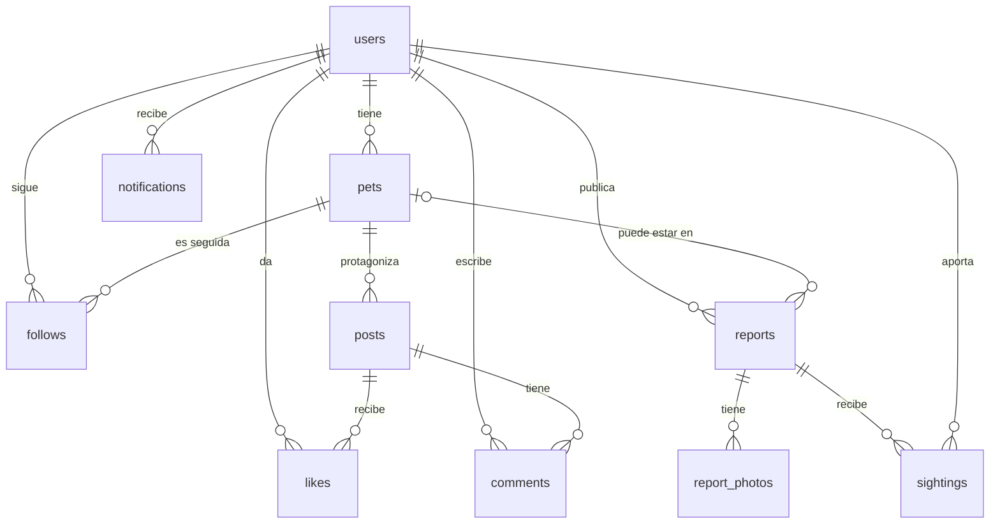

# Modelo de datos — Furrly (borrador v1)

Base de datos: PostgreSQL en Supabase, con la extensión **PostGIS** para las ubicaciones.

## Diagrama



## Tablas

### users
Perfil del dueño. Si usamos Supabase Auth, `id` coincide con `auth.users.id`.

| Columna | Tipo | Notas |
|---|---|---|
| id | uuid PK | |
| username | varchar(30) UNIQUE | para la URL `/u/:username` |
| display_name | varchar(60) | |
| avatar_url | text NULL | |
| bio | varchar(300) NULL | |
| alert_location | geography(Point, 4326) NULL | centro de la zona de alertas |
| alert_radius_km | smallint DEFAULT 5 | CHECK entre 1 y 50 |
| created_at | timestamptz DEFAULT now() | |

### pets
| Columna | Tipo | Notas |
|---|---|---|
| id | uuid PK | |
| owner_id | uuid FK → users | ON DELETE CASCADE |
| name | varchar(40) | |
| species | enum `species` | dog, cat, rabbit, bird, other |
| breed | varchar(60) NULL | |
| sex | enum `pet_sex` | male, female, unknown |
| birth_date | date NULL | se guarda la fecha, no la edad (la edad cambia) |
| color | varchar(60) NULL | útil para identificar en avisos |
| description | varchar(500) NULL | |
| photo_url | text NULL | |
| microchip | varchar(20) NULL | privado, nunca se expone en la API pública |
| created_at | timestamptz | |

### follows — un usuario sigue a una mascota
| Columna | Tipo | Notas |
|---|---|---|
| follower_id | uuid FK → users | |
| pet_id | uuid FK → pets | |
| created_at | timestamptz | |

PK compuesta `(follower_id, pet_id)` → no se puede seguir dos veces.

### posts
| Columna | Tipo | Notas |
|---|---|---|
| id | uuid PK | |
| pet_id | uuid FK → pets | ON DELETE CASCADE |
| image_url | text | obligatoria |
| caption | varchar(500) NULL | |
| created_at | timestamptz | índice `(pet_id, created_at DESC)` para el feed |

El autor se obtiene por `pets.owner_id` (no se duplica).

### likes
PK compuesta `(user_id, post_id)` + `created_at`.

### comments
| Columna | Tipo | Notas |
|---|---|---|
| id | uuid PK | |
| post_id | uuid FK → posts | ON DELETE CASCADE |
| user_id | uuid FK → users | |
| body | varchar(500) | |
| created_at | timestamptz | |

### reports — avisos de perdida / encontrada (el núcleo diferenciador)
| Columna | Tipo | Notas |
|---|---|---|
| id | uuid PK | |
| type | enum `report_type` | lost, found |
| status | enum `report_status` | active, resolved, cancelled |
| reporter_id | uuid FK → users | |
| pet_id | uuid FK → pets NULL | se rellena si es una mascota tuya perdida; NULL si encontraste una desconocida |
| species | enum `species` | duplicado a propósito: un aviso "found" no tiene `pet_id` |
| title | varchar(100) | |
| description | text | |
| location | geography(Point, 4326) | dónde se perdió / se encontró. Índice **GIST** |
| address_text | varchar(200) NULL | texto legible ("Parque del Retiro") |
| happened_at | timestamptz | cuándo se perdió / encontró |
| resolved_at | timestamptz NULL | |
| created_at | timestamptz | |

Reglas (CHECK):
- `type = 'lost'` ⇒ `pet_id IS NOT NULL`
- `status = 'resolved'` ⇔ `resolved_at IS NOT NULL`

### report_photos
`id`, `report_id` FK (CASCADE), `url`, `position` smallint. Varias fotos por aviso.

### sightings — "creo que la he visto aquí"
| Columna | Tipo | Notas |
|---|---|---|
| id | uuid PK | |
| report_id | uuid FK → reports | CASCADE |
| user_id | uuid FK → users | |
| location | geography(Point, 4326) | |
| seen_at | timestamptz | |
| note | varchar(300) NULL | |
| photo_url | text NULL | |
| created_at | timestamptz | |

### notifications
| Columna | Tipo | Notas |
|---|---|---|
| id | uuid PK | |
| user_id | uuid FK → users | destinatario |
| type | enum `notification_type` | new_report_nearby, new_sighting, report_resolved, new_follower, new_comment, new_like |
| actor_id | uuid FK → users NULL | quién la provocó |
| report_id / post_id / pet_id | uuid NULL | referencia al objeto implicado |
| read_at | timestamptz NULL | NULL = no leída |
| created_at | timestamptz | índice `(user_id, read_at, created_at DESC)` |

Se usan FKs explícitas en lugar de un `jsonb` genérico para mantener integridad referencial.

## Consulta clave: alertas por zona

Al crear un aviso, se notifica a los usuarios cuya zona de alertas contiene el punto:

```sql
SELECT id FROM users
WHERE alert_location IS NOT NULL
  AND id <> :reporter_id
  AND ST_DWithin(alert_location, :report_location, alert_radius_km * 1000);
```

Y el mapa de avisos activos cerca de mí:

```sql
SELECT * FROM reports
WHERE status = 'active'
  AND ST_DWithin(location, ST_MakePoint(:lng, :lat)::geography, :radius_m)
ORDER BY happened_at DESC;
```

## Notas para defender en entrevista
- **`geography` y no lat/lng sueltos:** las distancias salen en metros reales y el índice GIST hace la búsqueda por radio eficiente.
- **PKs compuestas** en `likes` y `follows`: la propia BD impide duplicados, sin lógica extra.
- **Enums de Postgres** para estados: valores inválidos imposibles.
- **CHECKs** que llevan reglas de negocio a la BD (un aviso "lost" siempre tiene mascota).
- **Prisma + PostGIS:** Prisma no soporta `geography` de forma nativa; se declara como `Unsupported("geography(Point,4326)")` y las consultas espaciales van con `$queryRaw` parametrizado.
- **Fuera del MVP:** chat entre usuarios, adopciones, moderación/reportes de abuso.
